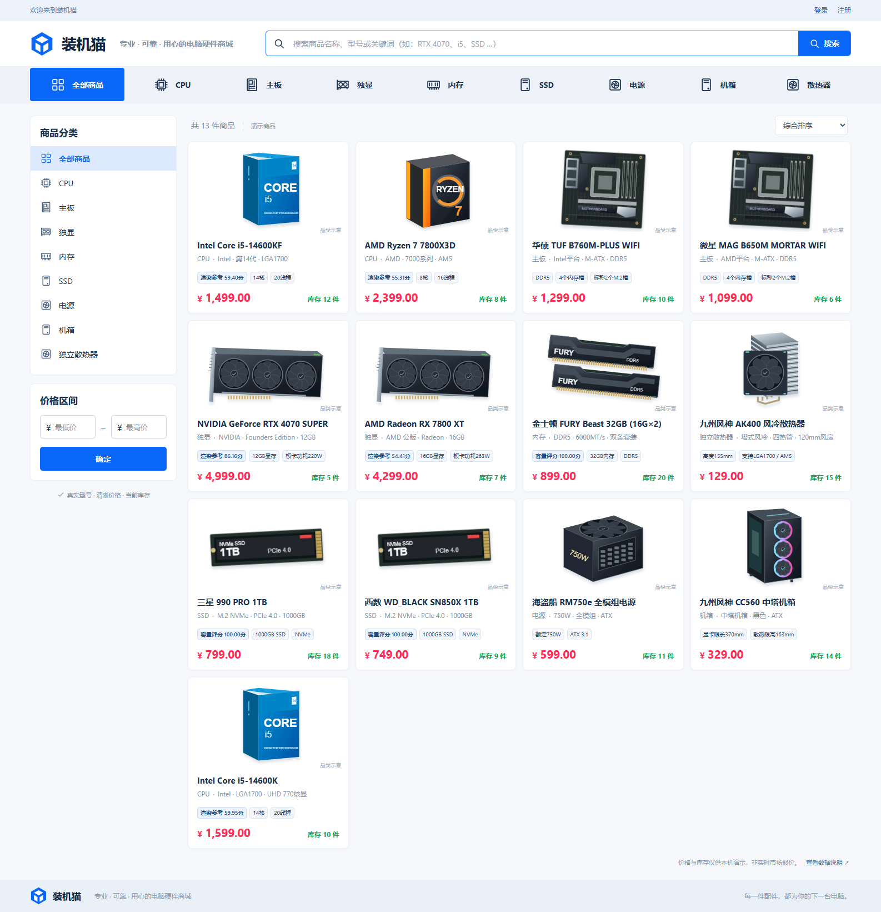
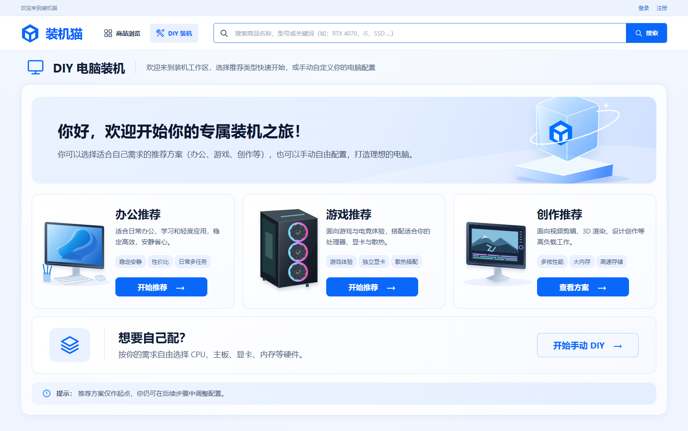
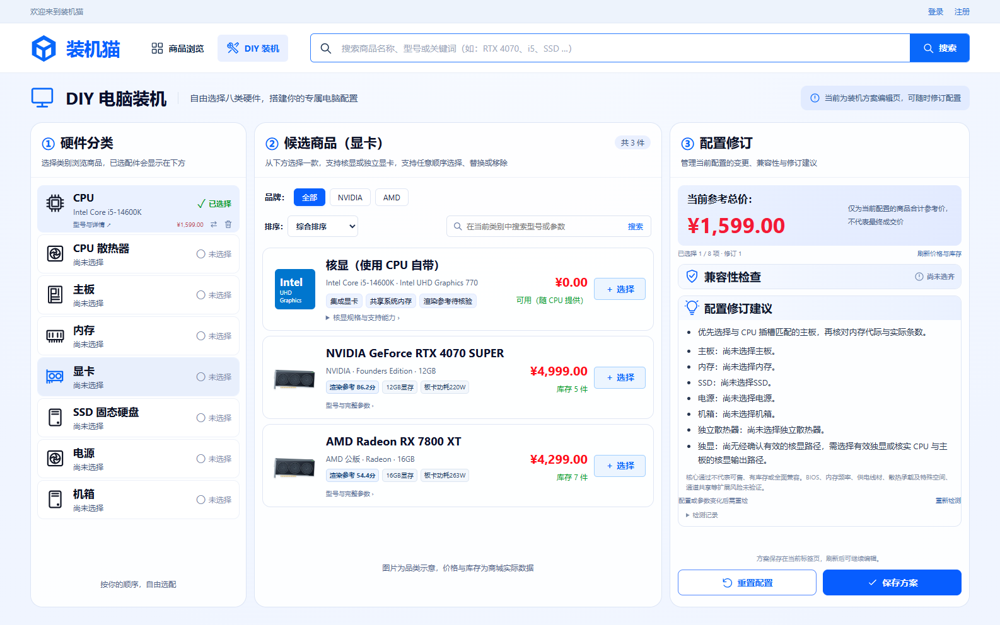
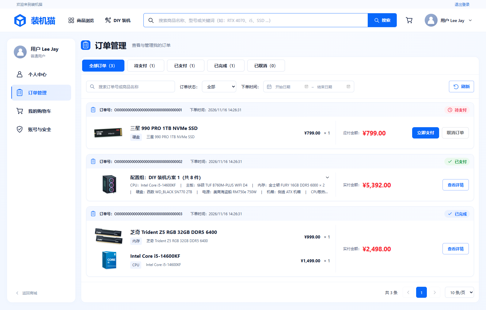

# 装机猫 · 电脑硬件商城与 DIY 装机平台

面向电脑硬件选购与 DIY 装机场景的全栈 Web 应用，打通**硬件检索、DIY 实时兼容检测、三场景预算推荐、单品与配置组混合交易、后台运营履约**完整链路。

`Java 21` · `Spring Boot 3.5` · `MyBatis 3` · `Flyway` · `MySQL 8.0` · `Vue 3` · `TypeScript` · `Element Plus` · `Playwright`

---

## 项目亮点

- **八类硬件与多维参数检索**：覆盖 CPU、主板、显卡、内存、SSD、电源、机箱、CPU 散热器 8 大品类（演示库初始 574 件在售商品），支持按分类、关键词、硬件参数、平台、品牌、容量、额定功率及价格区间组合筛选。
- **可核验的性能标签与评分体系**：CPU/GPU 接入基于 Blender 4.3.0 的公开渲染基准（共 875 份可离线校验的完整提交）与 Geekbench 参考数据，内存与 SSD 提供容量优先综合评分，商品卡片、详情与后台统一呈现。
- **DIY 装机工作区与实时兼容检测**：三栏交互式装机工作区，支持任意顺序选配、核显/独显切换、内存 1～4 根数量调节与实时参考报价；服务端统一执行插槽、内存代际、尺寸限高限长、功耗等核心规则（C01～C06、C08～C10）并给出修订建议。
- **办公 / 游戏 / 创作三场景预算推荐**：输入预算即可在当前在售有货目录中搜索满足场景门槛、核心兼容且在预算内的完整装机方案，展示分项权重与评分，并支持一键导入 DIY 工作区复验加购。
- **单品 + 配置组混合交易闭环**：支持单品与多套完整 DIY 配置组同时加入购物车和原子下单；同一事务内按 SKU 聚合预占库存并保存不可变成交快照，支持模拟支付、主动取消、30 分钟超时自动取消释放库存及后台履约完成。
- **生产级工程约束**：服务端权威校验（价格、库存、兼容、权限均不信任前端）、Session + CSRF + 登录限流安全防护、前后端同源单 JAR 交付、真实 MySQL 隔离测试与端到端 Playwright 验收。

---

## 界面预览

### 硬件商城与全商品性能标签
支持八类硬件浏览、多维参数筛选、渲染参考分 / 容量评分及关键规格展示。



### 智能装机推荐入口（办公 / 游戏 / 创作）
按预算与使用场景一键生成完整装机方案，也可直接进入手动 DIY。



### DIY 装机工作区与实时兼容诊断
三栏结构实时联动：左侧八类配件进度、中间候选硬件与核显选择、右侧参考总价与兼容性建议。



### 个人中心与订单管理
统一管理单品订单与 DIY 整组配置订单，支持状态筛选、日期检索、模拟支付与取消操作。



---

## 核心功能全景

| 模块 | 主要能力 |
| --- | --- |
| **硬件商城** | 八类硬件分页/筛选、关键词与参数检索、商品详情一致快照、性能标签与数据来源透明展示 |
| **DIY 装机** | 三栏选配、核显/独显显式选择、实时报价、自动/手动兼容性检测与修订建议、游客配置登录后自动续接 |
| **智能推荐** | 办公 / 游戏 / 创作三场景预算搜索、场景门槛与权重评分、失败原因细粒度分类、推荐方案导入 DIY 复验入车 |
| **购物车与下单** | 账户持久化单品购物车 + 完整配置组购物车、同 SKU 全车库存聚合、预结算复验、混合原子下单与成交快照 |
| **支付与履约** | 模拟支付（幂等与到期截止保护）、待支付主动取消、每分钟扫描超时自动取消并原子释放库存、管理员履约完成 |
| **账号与后台** | 注册/统一登录、Session + CSRF、登录失败限流、个人中心（昵称/头像/改密撤销旧会话）；后台商品草稿与八类参数维护、受控调价与调库存、性能评分管理、用户启禁、跨用户订单管理与原子审计 |

---

## 技术栈与架构特点

| 层次 | 技术选型 | 说明 |
| --- | --- | --- |
| **后端** | Java 21 · Spring Boot 3.5.16 · Spring Security · MyBatis 3.0.5 | 分层接口、事务与并发控制、Session/CSRF 与角色鉴权 |
| **数据库与迁移** | MySQL 8.0 · Flyway | 独立本地实例，演示库 `pc_mall_demo` 与测试库 `pc_mall_test` 权限隔离 |
| **前端** | Vue 3.5 · TypeScript 5.9 · Vite 8 · Element Plus 2.14 | 组件化 SPA，开发态代理 `/api`，构建后打入同源 JAR 静态资源 |
| **质量保障** | JUnit 5 · Spring Boot Test · Playwright 1.64（Edge） | 无内存库回退的真实 MySQL 集成测试 + 端到端浏览器自动化验收 |

**工程化设计亮点**：
1. **同源单 JAR 交付**：通过 Maven `-Pdemo` 将 `frontend/dist` 打包进 Spring Boot 可执行 JAR，一套进程同时提供前端页面、本地 SVG 资源与 `/api` 接口。
2. **严格的数据库与测试隔离**：本地启动脚本自动拉起隔离的 MySQL 8.0 实例（默认 `127.0.0.1:33307`），并为演示库和测试库分配最小权限独立账号；测试环境内置数据源守卫，杜绝误连演示库。
3. **可追溯的数据边界**：硬件性能基准附带原始数据、许可说明与离线 SHA-256 核验脚本，商品价格与库存明确标识为演示数据并与兼容结论解耦。

---

## 项目结构

```text
.
├── backend/       # Spring Boot + MyBatis 后端源码、Flyway 迁移（db/migration、db/catalog）及集成测试
├── frontend/      # Vue 3 + TypeScript 前端应用与 Playwright 端到端测试
├── data/          # 可离线校验的公开硬件性能参考数据包与许可说明
├── scripts/       # 本地隔离 MySQL 初始化、开发启动、同源打包、管理员引导与全量验收脚本
├── docs/          # 部署演示手册、开发与测试手册、各业务契约文档及验收证据
└── pom.xml        # Maven 配置与同源演示打包 profile（-Pdemo）
```

---

## 快速体验

> 本项目默认面向 Windows PowerShell 7 演示与验证；前置依赖为 **JDK 21**、**Node.js 22.12+** 与 **MySQL 8.0**（复用安装目录中的程序，不修改系统 MySQL 服务）。

### 1. 初始化项目隔离数据库

在仓库根目录执行（按本机实际路径调整 `JAVA_HOME` 与 `-MySqlHome`）：

```powershell
$env:JAVA_HOME = 'D:\Java'
$env:MAVEN_USER_HOME = "$PWD\.local\maven-user"
./scripts/local-db.ps1 -MySqlHome 'D:\MySQL\MySQL Server 8.0'
```

### 2. 构建并启动同源演示服务

```powershell
./scripts/package.ps1
./scripts/start-with-admin.ps1 -Username demo_admin
```

按提示输入初始管理员密码后，打开浏览器访问 **`http://127.0.0.1:8080`** 即可体验商城、DIY 装机、智能推荐与管理后台。

> 如需前后端分离热更新开发、查看完整环境变量表、或运行全量后端与 Playwright 自动化验收（`./scripts/test.ps1`），请参阅 [开发、配置与测试手册](docs/development.md)。

---

## 文档导航

### 入门、部署与开发
- [空库部署与五条演示路径](docs/delivery.md) — 从零部署、重启、演示步骤（游客浏览、DIY 登录恢复、三场景推荐加购、混合下单履约、取消与超时）
- [开发、配置与测试手册](docs/development.md) — 本地开发启动、环境变量契约、Flyway 迁移边界、单测与全量验收命令
- [任务 25 验收报告](docs/evidence/task-25.md) — 实测环境、执行记录与发布条件

### 核心业务与接口契约
- **商城与性能数据**：[分类参数](docs/catalog-parameters.md) · [目录扩展](docs/catalog-expansion.md) · [性能数据](docs/performance-data.md) · [全商品性能标签](docs/product-performance-tags.md) · [容量优先评分](docs/capacity-priority-scores.md) · [数据来源与许可](docs/data-sources.md)
- **DIY 与智能推荐**：[DIY 工作区](docs/diy-workspace.md) · [统一兼容检测](docs/compatibility.md) · [核显支持](docs/integrated-graphics.md) · [三场景预算推荐](docs/scenario-recommendation.md)
- **购物车与订单交易**：[单品购物车](docs/single-item-cart.md) · [配置组购物车](docs/configuration-cart.md) · [预结算复验](docs/cart-checkout-preview.md) · [混合下单](docs/mixed-orders.md) · [支付与订单历史](docs/order-payment-history.md) · [取消与超时释放](docs/order-cancellation-timeout.md)
- **账号与管理后台**：[认证与会话安全](docs/authentication.md) · [商品管理](docs/catalog-administration.md) · [价格与库存](docs/price-stock.md) · [用户管理](docs/user-administration.md) · [订单管理](docs/order-administration.md)
