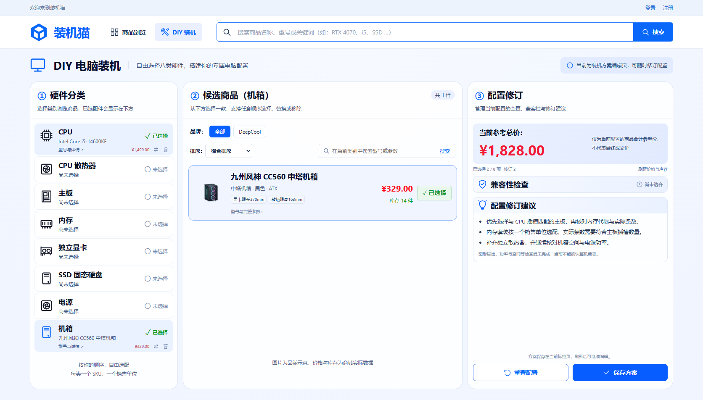

# DIY 参考图界面调整

日期：2026-11-07。范围：按用户提供的新参考图调整现有 `/#diy`，保留任务09的选配与报价、任务10的真实兼容分项诊断。用户要求不创建 Git 节点。

## 实现

- 三栏比例、浅蓝背景、圆角边框、顶部导航和搜索区按参考图调整。
- 左侧依次显示 CPU、散热器、主板、内存、独显、SSD、电源、机箱，已选条目显示真实商品名称、参考价、详情与替换/移除入口。
- 中间保留品牌、排序和类别内搜索；卡片使用当前商品接口、既有本地品类示意图、实际售价、库存与性能标签。
- 右侧改为参考总价、兼容性检查、配置修订建议和底部操作。按用户后续要求，移除常驻规则列表和底部展开入口，兼容性检查仅列红色冲突小点与名称，具体原因和对应解决建议放入配置修订建议；正常、缺件或未知只保留总体状态，服务端仍执行全部已实现规则。
- 重置保留二次确认；保存方案明确保存至当前标签页，成功反馈、失败提示和刷新恢复均可用。
- 修订建议根据当前选择与实际诊断生成；检测失败时提示先完成检测，不显示“已检查的项目没有发现冲突”。未完成的整机检查继续明确标记待核验。

没有新增后端接口、数据库迁移、永久方案库、第三方依赖或外部图片。

## 验证

| 检查 | 结果 |
| --- | --- |
| `npm.cmd run build` | TypeScript 与 Vite 构建通过 |
| `./mvnw.cmd -Pdemo -DskipTests package` | 同源演示 JAR 打包通过 |
| 首轮 Edge 全套浏览器回归 | 42/42 通过（原40条＋保存成功/保存失败两条） |
| 最终版 DIY 与兼容诊断专项 | 16/16 通过，覆盖选择、替换、移除、清空确认、报价异常、刷新恢复、旧响应保护、存储错误、保存及检测失败建议 |
| 最终桌面与窄屏检查 | 1672×940、390×844 视口均无横向溢出，无页面脚本错误；三栏顶端对齐，商品价格与库存来自真实隔离 MySQL 接口 |
| Git 差异检查 | `git diff --check 8687df3` 通过；HEAD 保持 `8687df35656bc5dd8bee18d0ba1e7ced8201543b` |

测试使用显式隔离的 `pc_mall_test`，临时服务、临时管理员在结束后清理；历史商品及任务09截图恢复运行前内容。本轮没有修改后端业务代码，没有创建提交、分支、标签或推送。

构建日志保留在 `.local/diy-ui-final-build.log`、`diy-ui-final-package.log`；最终浏览器运行结果亦由 Playwright 的 `frontend/test-results/.last-run.json` 记录。桌面/窄屏截图为真实浏览器页面，示例选择 CPU 与机箱后的参考合计为 ¥1,828.00。

后续“仅显示冲突小点”调整再次通过类型检查、Vite/同源打包及16/16浏览器回归：正常、缺件、未知均无规则列表；确认冲突仅显示对应问题，重检无冲突后隐藏；旧诊断响应携带的过期冲突不能覆盖当前状态。初轮15项通过，1项旧报价测试仍引用已移除区域中的“配置修订”文案，改为核对保留的报价区修订信息后16项全部通过。日志为 `.local/diy-conflict-points-final-tests.log`，浏览器摘要见上述 Playwright 结果。

## 界面

[窄屏界面](diy-ui-mobile.png)。

兼容性区域：[无冲突时的精简显示](diy-ui-compatibility.png)、[出现冲突时的问题小点](diy-ui-conflict.png)、[对应原因与解决建议](diy-ui-revision-advice.png)。冲突截图使用浏览器响应边界夹具验证 UI 展示，不作为真实硬件冲突或数据库状态的证据。

2026-11-08：按用户要求将兼容性检查进一步精简为冲突名称，解释与按规则提供的解决建议统一移入配置修订建议，未完成检查提示也移至该区。构建及16/16浏览器回归通过，断言冲突区不含原因/建议、建议区包含具体原因与更换方案、重检成功后旧原因消失。最终日志为 `.local/diy-conflict-advice-tests.log`，桌面及窄屏截图均已更新，无横向溢出或页面脚本错误。未创建Git节点。
