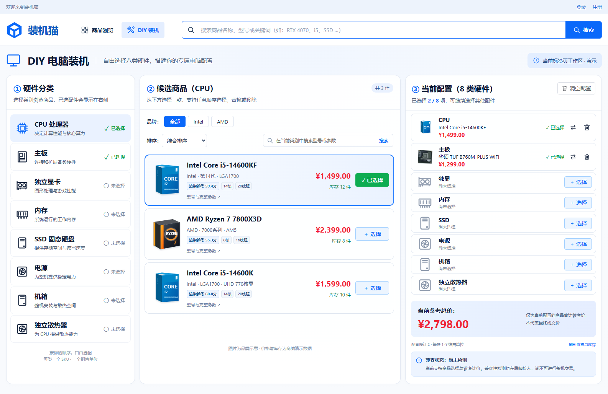

# 任务09验证记录

日期：2026-11-07（Asia/Shanghai）。任务：[DIY选配与当前标签页工作区](../../.scratch/pc-mall/issues/09-diy-workspace.md)。契约：[DIY工作区](../diy-workspace.md)。[两轴审查](task-09-review.md)。

## 已交付

按用户图片实现蓝白三栏工作区：八类硬件及选择状态、商城同源候选与完整参数、当前配置清单及服务端参考价。支持任意顺序、同类替换、移除、确认/取消清空；每类一个SKU及一个销售单位，内存套装不按条数倍增购买数量。

服务端只读事务报价，BigDecimal金额字符串，逐项返回下架、缺货、不存在和类别不匹配问题，失效项不计价且不显示完整总价。前端即时保存引用、来源与修订，刷新重新报价，取消/过期响应保护；异常保留编辑引用，损坏存储不在挂载时删除，写入失败仍可编辑。兼容状态固定“尚未检测”，没有兼容准入或整机交易入口。

本票不新增持久化结构，无数据库迁移；复用既有MySQL商品、库存与售价。没有新增依赖、外部模板或图片，使用现有原创品类SVG；不复制参考图片的样例金额和商品数量。

## 环境与边界

- Windows、JDK21、项目Maven Wrapper、现有锁定Node/Vue/Element Plus/Playwright依赖、Microsoft Edge。
- 真实MySQL8.0.45，显式`pc_mall_test`测试schema与同名受限账户，无内存数据库回退。`.local/env.ps1`加载本地配置，不在证据中输出密码。
- 原报告SHA-256 `249a347c08f998e2d8f244bc332098da628a697359cf1a3239ed74dcf399f765`；矩阵`a950301df806976c8d93e57a0c07301aebd52d10c141260415e457c72eaaee23`，与规格一致。读取了原F02要求及验收表。
- 用户确认HTTP报价与浏览器操作两个TDD公开测试边界。所有断言观察HTTP或页面结果，MySQL写操作仅准备/清理本票独立负面夹具，不修改正常商品夹具。

## 执行记录

| 命令/检查 | 结果 |
| --- | --- |
| `. ./.local/env.ps1; ./mvnw.cmd '-Dtest=DiyWorkspaceTest' test` | 4/4通过：任意顺序/套装金额、结构输入拒绝、失效引用、价格库存与上下架变更后重报价 |
| `cd frontend; npm.cmd run typecheck` | 通过；开发循环多次执行 |
| `.local/task-09-browser.ps1`（由现有浏览器隔离脚本派生，专用18089端口） | 8/8 Edge通过：编辑/清空/恢复、503保留与重试、旧响应竞态、八类与详情、下架/缺货反馈、已登录访问、损坏存储、写入失败 |
| `./scripts/test.ps1` | 真实MySQL后端69/69、Edge全套34/34、类型检查、Vite构建与同源JAR打包全部通过 |
| `.local/task-09-browser.ps1`（审查修复后） | 类型检查、构建与DIY专项8/8再次通过，包含CPU当前类别下确认清空重置排序的断言 |
| `git diff --check` | 通过 |
| 1586×992浏览器截图人工检查 | 三栏、商品示意、选择状态、价格及尚未检测提示可见；截图见下 |

本地详细日志（忽略文件）：`.local/task-09-red-api.log`、`task-09-green-api.log`、`task-09-api-boundaries.log`、`task-09-red-browser.log`、`task-09-green-browser.log`、`task-09-browser-boundaries.log`、`task-09-full-tests.log`、`task-09-reviewed-browser.log`。

过程如实记录：初次沙箱内MySQL连接不可用，未视作业务测试失败证据；允许本机连接后，接口测试先因游客报价入口未实现返回401而失败，浏览器先因DIY入口缺失而失败。后续无效选择测试发现全局JSON空值省略，已用报价记录显式包含null修复。测试开发中修正了CPU/散热器名称匹配歧义，以及误用参考图片金额的断言，独立期望改按仓库V2迁移夹具（内存899元、7800X3D2399元）；没有改数据库去迎合图片。最终单文件4/4和8/8均通过。

## 验收关联

| 原场景 | 本票证据及限制 |
| --- | --- |
| F02-T01 / T02 / T03 | 游客进入、非固定顺序、同类替换由浏览器真实请求验证 |
| F02-T04 | 移除与金额、选择计数更新已验证；兼容规则由10/11接入 |
| F02-T10 / T11 | 真实MySQL独立夹具验证下架和变价报价；浏览器网络边界模拟下架/缺货展示，不冒充管理员数据库变更证据 |
| F02-T12 | 同标签页刷新恢复、重新报价已验证 |
| F02-T17 | 清空确认/取消及确认后刷新仍为空已验证 |
| SYS-T02 | 本票选配、替换、清单与未检测状态已验证；完整兼容检查不在本票范围 |

补充用例独立命名，没有伪造新的冻结验收编号。不宣称任务10/11兼容检查、任务12登录自动交接、购物车或交易已完成；不包含性能验收。

## 界面与Git交付

仅保留工作区文件改动。遵照本次用户指令，不执行commit、分支、标签、stash、push或其他Git写操作；审查采用开始时`ff7a56d4c3e5f64598edba6a5286a7964c654fa6`与当前工作区及新增文件比较。原有未跟踪`.idea/jsLibraryMappings.xml`保留不动。全套测试重新生成的旧任务截图已恢复为运行前文件，以免混入本票改动。最终核对HEAD及本地引用均未变化。
