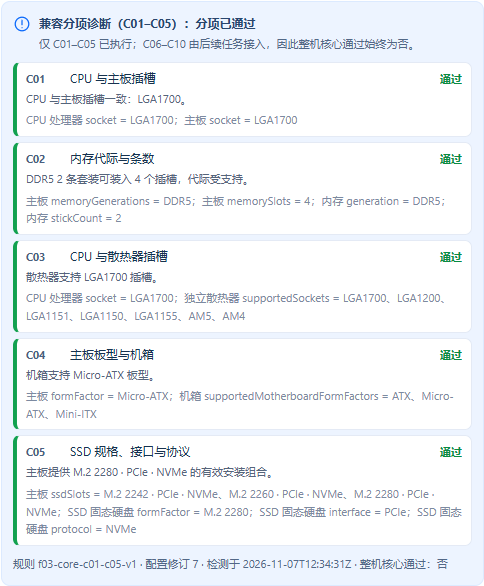

# 任务10验证记录

日期：2026-11-07（Asia/Shanghai）。任务：[插槽、内存、板型与SSD兼容诊断](../../.scratch/pc-mall/issues/10-compatibility-foundation.md)。契约：[兼容分项诊断](../compatibility.md)。[两轴审查](task-10-review.md)。

## 已交付

统一兼容规则服务的首个切片 C01～C05：

- 公开 `POST /api/compatibility/check`，匿名可用但遵循既有 CSRF 策略，`Cache-Control: no-store`，不写库、不占库存。
- 服务端按商品 ID 读取 `products` 与 `product_specifications.parameters` 当前值；客户端只能提交修订号和商品引用，参数、类别覆盖、价格、`compatibility`、`corePassed` 等声称字段一律 400。
- 严格 JSON 解析拒绝重复键；重复 `CPU` 不会被静默合并。
- 分项状态区分 PASS / FAIL / UNKNOWN / PENDING；缺件为 PENDING，关键参数为 null、空集合或缺少来源为 UNKNOWN。参数无来源不按通过处理。
- C02 使用套装实际 `stickCount`，不用购买数量；C05 只匹配 V10 的显式 `ssdSlots` 组合，涵盖「M.2 物理位存在但只核验为 SATA/AHCI」的协议差异。
- 每条规则返回编号、关联类别、实际读取的参数、可读解释和逐项值；局部失败不清空其他结果。
- `corePassed` 恒为 `false`，`unexecutedRules` 明确列出 C06～C10 未执行，不冒充整机通过。
- `/#diy` 第三栏展示分项诊断，选择变化后与报价并行重算；检测失败保留编辑并支持重试，旧响应不覆盖新配置。

未新增数据库结构或迁移：规则读取 V4/V10 已核验参数。没有新增第三方依赖，规则为按冻结规格原创实现。

## 环境与边界

- Windows、JDK 21.0.10、项目 Maven Wrapper 3.9.11、既有锁定 Node/Vue/Element Plus/Vite/Playwright 依赖、Microsoft Edge。
- 真实 MySQL 8.0.45，显式 `pc_mall_test` schema 与同名受限账户，无内存数据库回退；`.local/env.ps1` 加载本地配置，不在证据中输出密码。
- 用户确认三处 TDD 公开边界：HTTP 接口（真实隔离 MySQL）、规则单元测试、浏览器实际操作。
- 原报告 SHA-256 `249a347c08f998e2d8f244bc332098da628a697359cf1a3239ed74dcf399f765`，矩阵 `a950301df806976c8d93e57a0c07301aebd52d10c141260415e457c72eaaee23`，与规格一致。

## 执行记录

| 命令/检查 | 结果 |
| --- | --- |
| `. ./.local/env.ps1; ./mvnw.cmd '-Dtest=DiyWorkspaceTest' test` | 基线 4/4 通过（开工前） |
| `./mvnw.cmd '-Dtest=CompatibilityRulesTest' test` | 21/21 通过：C01 正反例与未选/未知/无来源、C02 代际与超插槽条数、C03、C04、C05 显式组合与协议冲突、五规则恒定顺序、details 只含实际读取参数、畸形集合与畸形安装组合降级为 UNKNOWN、PENDING 消息不含枚举码 |
| `./mvnw.cmd '-Dtest=CompatibilityCheckTest' test` | 8/8 通过：真实数据库全通过、真实库冲突只失败一项、M.2 仅 SATA 时按协议冲突、缺件/失效商品、真实库清空来源后 UNKNOWN 且其他规则不受影响、真实库畸形值降级为 UNKNOWN、客户端声称字段与重复键拒绝、同配置确定性 |
| `cd frontend; npm.cmd run typecheck` | 通过；开发循环多次执行 |
| `.local/task-10-browser.ps1` | Edge 6/6 通过：分项展示、未选齐、冲突、未知、检测失败重试、旧响应竞态 |
| `.local/task-10-browser.ps1 -Spec ... (diy-workspace)` | 回归 14/14 通过（诊断 6＋既有 DIY 8） |
| `./scripts/test.ps1` | 真实 MySQL 后端 98/98、Edge 全套 40/40、类型检查、Vite 构建与同源 JAR 打包全部通过 |
| `git diff --check 8687df3` | 通过 |

本地详细日志（忽略文件）：`.local/task-10-red-rules.log`、`task-10-green-rules.log`、`task-10-red-api.log`、`task-10-green-api.log`、`task-10-green-backend.log`、`task-10-red-browser.log`、`task-10-green-browser.log`、`task-10-full-tests.log`。

过程如实记录：初版规则测试因类别枚举归属与测试夹具写法编译失败，逐项修正；首轮接口测试暴露三处真实缺陷——`details` 按类别×参数做笛卡尔积产生了目录中不存在的组合（已改为按实际读取的 (类别, 参数) 对生成并补规则测试）、重复 JSON 键被静默合并（改为严格解析）、`@RestControllerAdvice` 优先级被商品模块兜底处理器抢占导致 400 变 500（已置最高优先级并限定到本包）。首轮浏览器测试因 PowerShell 5.1 不支持 `-SkipHttpErrorCheck` 导致就绪探测失败，修正后 6/6 通过；前端守卫也因上述 `details` 缺陷正确拒绝了响应，暴露问题后才修好，未放宽断言。

两轴审查另发现三处真实缺陷并已修复：非文本集合条目与畸形安装组合会抛异常变成 500（改为降级 UNKNOWN，规则与真实库各补用例）、PENDING 消息泄露 `MOTHERBOARD` 之类枚举码（改为中文标签）、已选但下架/不存在的配件在界面被笼统说成「待选择」（`missing` 每项按自身 state 分列展示）。同时删除了重复异常类型、未使用字段与死代码，并补真实库 UNKNOWN 用例。详见[两轴审查](task-10-review.md)。

## 验收关联

| 原场景 | 本票证据及限制 |
| --- | --- |
| F03-T01 / T02 | 服务端读取当前商品参数，客户端声称参数与通过标识被拒 |
| F03-T05 | C01 CPU/主板插槽正反例（真实 MySQL 改动主板 socket 后只失败 C01） |
| F03-T06 / T07 | C02 DDR 代际与实际条数（含超插槽条数） |
| F03-T09 | C05 M.2 规格/接口/协议与协议差异、显式安装组合 |
| F03-T11 / T12 / T13 | 缺件 PENDING、未知 UNKNOWN（含真实库无来源与畸形值）、冲突 FAIL 与局部失败保留其他结果 |
| F03-T18 | 游客可用、未选齐仍执行已有输入条件的规则 |
| F02-T04 | 分项诊断随选择变化更新，报价与诊断并行 |

补充用例独立命名（如「M.2 仅 SATA 时按协议冲突」「details 只含实际读取参数」），没有伪造新的冻结验收编号。不宣称 C06～C10、功率、空间、核显路径、综合五态汇总、登录自动交接、购物车或交易已完成；不包含性能验收。

## 独立复审修复与验收

2026-11-07：按用户要求修复并验收独立复审发现的两个 P2，覆盖 F03-T06/T07、F03-T09、F03-T11/T12/T13 的本票适用部分；新增用例为补充回归，不新增冻结验收编号。

| 执行命令 / 检查 | 结果 |
| --- | --- |
| `./mvnw.cmd '-Dtest=CompatibilityRulesTest' test`（修复前，仅新增回归） | 28 条中 6 项断言失败、1 项空指针错误，确认能捕获错误类型误判与已知冲突被未知字段遮蔽 |
| 同一规则命令（修复后） | 28/28 通过，新增 7 条回归覆盖错误类型、正整数范围、词汇及混合已知/未知条件 |
| `./mvnw.cmd '-Dtest=CompatibilityRulesTest,CompatibilityCheckTest' test` | 40/40 通过：规则 28＋真实隔离 MySQL HTTP 12；新增 4 条 HTTP 回归确认字段异常不会变 500、条数不被强制转成 0、C02/C05 仍报告确定冲突 |
| 原始最小复现探针 | DDR 冲突＋未知条数：FAIL；SSD 规格冲突＋未知协议：FAIL；字符串条数：UNKNOWN；数组插槽：UNKNOWN，无异常 |
| `./scripts/test.ps1` | 后端 109/109、Edge 40/40、类型检查、Vite 构建、同源 JAR 打包全部通过 |

验收环境及隔离约束同前：只使用 `pc_mall_test`，HTTP 夹具克隆商品并在 finally 中删除，不修改演示商品。修复直接复用商品管理的字段校验；C02/C05 的确定冲突优先，缺失或畸形字段不作为通过依据。未增加 C06～C10、依赖或迁移。本轮两项均通过验收，审查记录见[任务10两轴审查的补充结论](task-10-review.md#独立复审的两项-p2-修复验收)。

本地详细日志：`.local/task-10-fix-red-rules.log`、`task-10-fix-green-rules.log`、`task-10-fix-targeted.log`、`task-10-fix-original-probe.log`、`task-10-fix-full-tests.log`；探针源码归档于 `.local/debug/task-10-review/`。

## 界面与Git交付

仅保留本票相关改动。遵照用户指令，不执行 commit、分支、标签、stash、push 或其他 Git 写操作；审查采用开始时的 `8687df35656bc5dd8bee18d0ba1e7ced8201543b` 与当前工作区比较。原有未跟踪 `.idea/jsLibraryMappings.xml` 保留不动。
