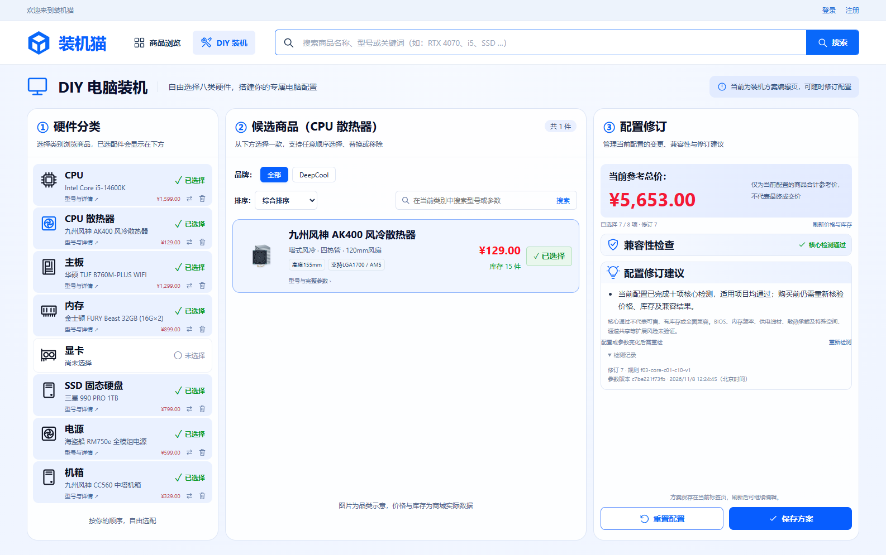

# 任务11：完整核心准入验证记录

日期：2026-11-08（北京时间）。任务：[11：图形输出、功率、空间与完整核心准入](../../.scratch/pc-mall/issues/11-compatibility-admission.md)。接口契约见[统一兼容检测](../compatibility.md)。

## 交付与环境

补齐 C06～C10，与既有五项统一执行；七类基础硬件始终必需，条件独显依据已核实核显路径判定。综合状态保留 CORE_PASSED、INCOMPATIBLE、INCOMPLETE、UNVERIFIED、ERROR，正常时 FAIL 优先于缺件、缺件优先于 UNKNOWN，所有明细保留。`corePassed` 只有完整且十项适用核心检查实际通过才为真。

后端按当前商品引用读取一致技术参数快照，返回规则版本、配置修订、检测时间和参数指纹。核显同时验证 CPU 能力、匹配插槽及主板输出；独显验证输出和适用安装检查；功率用精确十进制冻结公式，尺寸/功率相等通过。下架和缺货由报价/交易独立处理，不混同核心兼容。不存在的已选 GPU 不会被当作无独显而将功耗计0。

前端保留冲突区仅显示冲突名称、原因与建议放修订建议的布局；补缺件、未知参数、检测记录与范围说明。选择变化、手动重检、核价刷新、窗口激活、重新可见及可见页面每30秒自动重检；新请求清除旧结果，请求身份和修订保护拒绝旧响应，旧规则版本或不完整/自相矛盾的成功响应也拒绝。

- Windows、JDK21、项目 Maven Wrapper、锁定 Vue/TypeScript/Vite/Playwright 依赖、Microsoft Edge。
- 真实 MySQL8.0.45，仅显式受限 `pc_mall_test` 库及同名账户；无内存库或演示库回退。测试克隆商品并在 finally 清理自己的夹具。
- 母规格已确认规则入口、HTTP 与浏览器三个测试边界；按此实施 TDD。
- 原报告 SHA-256：`249a347c08f998e2d8f244bc332098da628a697359cf1a3239ed74dcf399f765`；矩阵：`a950301df806976c8d93e57a0c07301aebd52d10c141260415e457c72eaaee23`，本次重新读取原文件并核实一致。
- 无迁移、无新增依赖、无外部代码/数据引入；不改变已核验数据或用 TDP 填补未知峰值。

## 执行命令与结果

所有 Maven 命令先加载 `. ./.local/env.ps1`，不在输出或证据保存凭据。本地网络被沙箱阻止时仅通过受控授权运行隔离测试。

| 命令/检查 | 结果 |
| --- | --- |
| `./mvnw.cmd '-Dtest=CompatibilityAdmissionRulesTest' test` | C06、C08、空间与 C07 各纵向切片均先失败（规则不存在）后通过；最终新增5项测试覆盖正反、边界、未知/畸形/无来源及不适用 |
| `./mvnw.cmd '-Dtest=CompatibilityCheckTest#completeDiscreteBuildGetsTheOnlyCoreAdmissionAndVersionIdentity' test` | 先断言失败（缺少 CORE_PASSED），补齐统一准入后通过 |
| `./mvnw.cmd '-Dtest=CompatibilityRulesTest,CompatibilityAdmissionRulesTest,CompatibilityCheckTest,CompatibilityFailureTest' test` | 开发阶段50/50通过；后续新增边界与失效GPU回归纳入最终全套 |
| `npm.cmd run typecheck` | 开发中多次通过；初次新增计时器类型冲突已修正 |
| `.local/task-11-browser.ps1 -Spec @('tests/compatibility-diagnostics.spec.ts','tests/diy-workspace.spec.ts')` | 19/19通过（兼容9＋DIY10），含自动/手动、响应乱序、参数更新、旧版本和伪造汇总保护 |
| `./scripts/test.ps1` | 后端122/122、Edge浏览器45/45、前端类型检查、Vite与同源JAR构建全部通过 |
| `git diff --check 1113af9` | 通过 |

最终后端 F03 共53项：既有规则28、新增规则5、真实 MySQL HTTP19、实际不可连接端口故障注入1。C08 用原报告独立算例 125W＋200W→527W，与无独显267W边界；实际商品峰值181W＋GPU220W→626W。空间测试覆盖相等与0.01mm超限。未知峰值不取TDP兜底。

开发过程如实记录：首次 HTTP 测试连接被沙箱阻止，受控授权后才获得真正的失败断言；新增规则夹具曾引用其他测试类的私有 `json`，导致测试编译失败，已改为既有公开夹具值。首轮浏览器正确拒绝旧的 `corePassed:false` 前端契约；接入新契约后，旧状态断言与不可截图的布局容器又造成失败，已分别校正为冻结语义和页面截图，最终19/19通过。未降低规则准入或前端响应验证来使测试通过。

本地忽略日志：`.local/task-11-{red-c06,green-c06,red-c08,green-c08,red-space,green-space,red-c07,green-c07,red-admission,green-admission,red-browser,green-browser,backend-focused,browser-focused,full-tests}.log`。

## 原验收关联与限制

| 原编号 | 本票可核验行为 |
| --- | --- |
| F02-T05 / F03-T10 / F03-T19 | 七类有效核显完整并核心通过；无GPU C06/C09不适用；独立散热器仍必需 |
| F02-T06 / F03-T11 | 无核显且无独显，C07 FAIL；同时保留条件GPU缺失 |
| F02-T07～T09 | 八类明细与参考总价、冲突可继续编辑、必需件移除后立即失效；交易入口尚未开放 |
| F03-T17～T18 | 配件缺失、明确冲突和未知参数分层，优先级及全部明细保留 |
| F03-T09 | 安装接口冲突/匹配/无可用槽/未知；不按PCIe代际自动失败 |
| F03-T12 | 无核显但有效独显路径可通过；有输出但长度冲突不能伪装有效路径 |
| F03-T13～T16 | 冻结功率公式、恰好相等、显卡长度与散热器高度的精确边界 |
| F03-T20～T22 | 配置替换自动检测、旧响应晚到保护、游客可用 |
| F03-T23 | 真实不可连接数据库的HTTP503/ERROR，浏览器异常不保留旧通过、重试恢复 |
| F07-T16 | 规则静态固定，无后台停用入口；客户端规则开关及版本覆盖拒绝400 |
| SYS-T12 | 核心不兼容、未知参数及缺件不授予核心通过；浏览器拒绝不完整或自相矛盾的通过响应 |

F03-T24 跨购物车伪造提交的完整验收依赖后续 F05，本票仅核验兼容入口拒绝伪造通过字段，不宣称购物车已完成。推荐、订单等下游复用由对应任务完成；本票仅交付统一可调用服务。未执行任务24的并发/P95性能验收。未执行 P1 扩展风险判断，E01～E06 明确未执行；核心通过不代表全面兼容、价格正确、在售、有货或权限充足。

补充测试使用独立行为名称，不伪造冻结编号；本表依照本次原报告对应章节映射，不沿用早期证据的简写编号推断。两轴审查规范与规格最终均0项遗留，见[审查记录](task-11-review.md)。

## 界面及工作区交付

历史任务截图保留；本票另存核心通过、待选择、冲突、建议与工作区五张截图。用户确认基线 `1113af9dec3b1bc80b68110bcc28d3ca58bac528`、只保留工作区；未提交本地Git、未创建分支/标签或推送。原有未跟踪 `.idea/jsLibraryMappings.xml` 保留不动。
