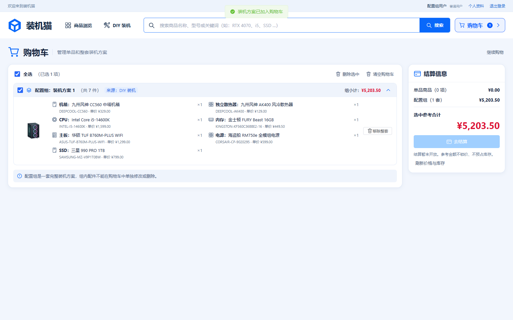
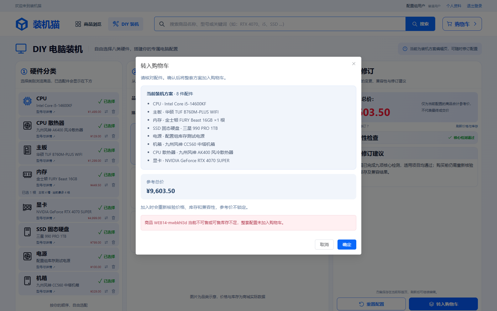

# 任务14：合法配置整组入车与去重

执行日期：2026-11-11（Asia/Shanghai）。任务及验收范围见[任务14](../../.scratch/pc-mall/issues/14-configuration-cart.md)，接口见[配置组契约](../configuration-cart.md)。

## 基准与范围

- 用户确认审查基准为 `6ecd727d7e2169fa241643d3694be96f6743ae4f`（Task-13），后续明确要求不做本地Git保存；最终在当前 `Test` 分支只保留工作区改动，不暂存或创建Git提交。审查因此对比基准与当前工作区，并直接读取新增文件，不要求先创建提交。
- 沿用母规格中已确认的公开后端业务接口、浏览器行为及真实隔离 MySQL 测试边界。
- 用户确认保留既有内存1～4根能力，其他类别各1件；不恢复已移除的 C07，显卡仍须明确选择核显或独显。
- 基准已包含 V20/V22 表结构、基础配置组入车与页面。本次补齐复验与一致性缺口、严格输入和响应校验、明细展示及完整验收证据，不重新建立购物车或修改已执行迁移。
- 开始时已有 `AGENTS.md` 修改和未跟踪 `.idea/jsLibraryMappings.xml`，本次未改动或提交它们。

## 环境与命令

Windows、Oracle JDK 21.0.10、MySQL 8.0.45，Node/npm/Edge 使用仓库既有安装。Maven Wrapper 和 npm 锁文件均保持原版本。测试使用 `test` profile、`pc_mall_test` schema 及同名受限账户；没有使用演示库或内存数据库。

```powershell
$env:JAVA_HOME = 'D:\Java'
$env:MAVEN_USER_HOME = Join-Path $PWD '.local/maven-user'
. ./.local/env.ps1
./mvnw.cmd -Dtest=ConfigurationCartTest test
./mvnw.cmd '-Dtest=ConfigurationCartTest,SingleItemCartTest' test
cd frontend
npm.cmd run typecheck
cd ..
./scripts/test.ps1
```

开发浏览器循环用 `.local/task14-browser.ps1`：从原 `scripts/test.ps1` 生成，仅把后端全测改成编译、浏览器命令改成 `npm.cmd test -- configuration-cart.spec.ts`，其余隔离服务、同源打包、临时管理员及清理逻辑相同。该临时脚本和日志不提交；最终完整命令仍使用原测试脚本。

初次沙箱内连接被系统拒绝（10013）；第一次提权测试时数据库服务尚未在沙箱外就绪，启动失败。这些均为环境失败，不计作业务测试。经沙箱外启动现有项目 MySQL 后执行下列真实验证，没有重建或删除数据库。

## TDD 与专项结果

| 行为 | 修复前实际失败 | 修复后结果 |
| --- | --- | --- |
| 重复 JSON 字段 | `duplicateJsonFieldsCannotHideASecondSelectionOrForgedContent` 期望400，实际200并创建组 | 严格解析配置原文，专项1/1通过 |
| 重复配置当前库存复验 | `duplicateConfigurationStillRevalidatesCurrentAvailabilityWithoutAddingDemand` 将库存改为0后期望409，实际200 | 去重仍复验，已有组新增需求为0；专项2/2通过 |
| 并发商品写入 | `configurationWaitsForCatalogWriteAndValidatesItsCommittedStock` 持有商品写事务、提交库存0后，入车仍用旧快照返回200 | 购物车锁后按商品ID升序共享锁定，快照建立在锁后；配置组＋单品18/18通过 |
| 残缺组响应 | 浏览器删除成功响应中的散热器明细后，页面直接显示成功，没有错误 | 必要类别、唯一引用和数量校验；浏览器1/1通过 |
| 组内SKU可见 | 七类配置入车成功，但明细缺少 `INTEL-I5-14600K` | 增加真实SKU和现价；浏览器2/2通过 |
| 响应丢失反馈 | 服务端真实提交后断开响应，页面只显示 `Failed to fetch` | 明确结果未知并允许用户重试核对；浏览器3/3通过 |

最终后端专项 `ConfigurationCartTest` **10/10通过**；最终浏览器专项 `configuration-cart.spec.ts` **4/4通过**，各次重建均包含 TypeScript 检查。日志分别保存在本机 `.local/task14-backend.log`、`.local/task14-browser.log`；各次先失败后通过的日志使用 `.local/task14-red-*` / `task14-green-*` 及 `task14-browser-red-*` / `task14-browser-green-*`。

验证中还修正了两处测试假设：未公开的组内路由没有405契约，改从已公开单品接口验证不能拆改组内明细，断言404/`CART_ITEM_NOT_FOUND`且整组不变；核显预览包含单独的显卡选择行，预览为8行而实际销售明细仍为7类。未为这两处假设新增接口或改写无关错误处理。

## 验收覆盖与证据限制

任务票关联 F05-T07～T14、T17～T18，F02-T14～T16，SYS-T06～T07。下表说明本次可复现的关联范围；未逐项冒称跨任务原验收已完整执行。本地没有原报告和追踪矩阵文件，本次以仓库母规格、任务票、现有兼容/DIY契约及用户确认的数量调整实施。

| 本次场景 | 可观察结果 |
| --- | --- |
| 七类核显与八类独显 | 真实HTTP生成完整7/8类组，内存4根金额分别为6552.00/11451.00；游客浏览器恢复后需再次主动确认 |
| 完整性、未知、伪造通过和类别 | 缺件、参数未知、错误类别、重复类别、伪造字段、非法内存数量均拒绝且无部分组 |
| 第八项真实写入失败 | 专用测试库对私有散热器SKU临时增加 CHECK 故障约束；第八条插入返回503，全车公开读取与失败前完全相同；移除约束后重试产生完整8项 |
| 并发重复去重 | 4个同账户请求用屏障同时启动，交替提交相反顺序；全部返回同一组、同一修订1，没有重复组 |
| 名称与价格变化 | 同SKU改名、CPU现价1499.00→1500.01，重提仍是原组、原修订，现价总额10103.51；额外客户端名称/来源/金额被拒绝 |
| 聚合库存与并发 | 单品99件＋两个不同组各1件CPU，在库存101时成功；再加第三组被拒。并发单品/配置争抢库存1时仅一个成功，另一个409，最终只一项 |
| 单品与组身份 | 同SKU单品、不同内存数量的组分别保留；删除单品不删除组，组整体删除、重登恢复及他人删除404通过 |
| 库存和事务边界 | 读取、成功入车、失败回滚均不改变私有夹具库存/预占数；没有新增预占明细。外部商品写事务提交后按其现时库存拒绝 |
| 浏览器失败与重试 | 真实后台把确认栏中的测试电源库存改为0后整组拒绝；确认栏与工作区保留。实际已提交响应被丢弃后，用户重试仅保留1组 |
| 残缺响应 | 仅在浏览器网络边界截断返回明细，验证页面不接受半组；不把此项冒称数据库故障回滚证据 |

独立数据库故障约束只作用于本测试私有SKU，并在 `finally` 移除。后端清理只删除随机前缀夹具和账户；浏览器临时管理员由原脚本删除，浏览器测试商品经公开后台下架。

## 完整回归与审查

原命令 `./scripts/test.ps1` 整体退出0：真实 MySQL 后端 **156/156通过**，TypeScript、Vite、同源JAR打包通过，Edge全套 **91/91通过**（3.8分钟）。没有失败或跳过的后端用例；完整日志为本机 `.local/task14-full.log`。脚本已停止自身浏览器服务并清理临时管理员。

完整浏览器套件重写的13张原有截图已按开始前内容恢复，仅保留本次两张新增截图；恢复使用只读 `git show` 提取原始字节，没有修改Git索引或提交。

完整回归后依照 code-review 技能，以两个全新上下文子代理并行只读审查规范与规格；两轴均0项，未要求修改实现。完整报告及工作区审查适配说明见[任务14审查记录](task-14-review.md)。审查后的收尾仅更新任务状态、README内存数量说明与证据文档，代码未再变化；任务状态已设为 `resolved`。

最终只保留工作区改动：HEAD仍为 `6ecd727`，没有暂存、提交或推送，原有用户变更保持不动。

## 界面核验

已查看以下实际 Edge 截图，确认桌面布局中SKU、现价、固定数量和整组操作可见，缺货错误留在确认栏且没有成功提示。





## 阶段边界

本次没有新增迁移、依赖或外部代码/数据；整组编辑、失效兼容诊断、混合预结算由任务15实现，订单、支付及库存预占由后续任务实现。并发行为测试不等同于任务24的压力与P95性能验收，本次未执行该性能验收。
