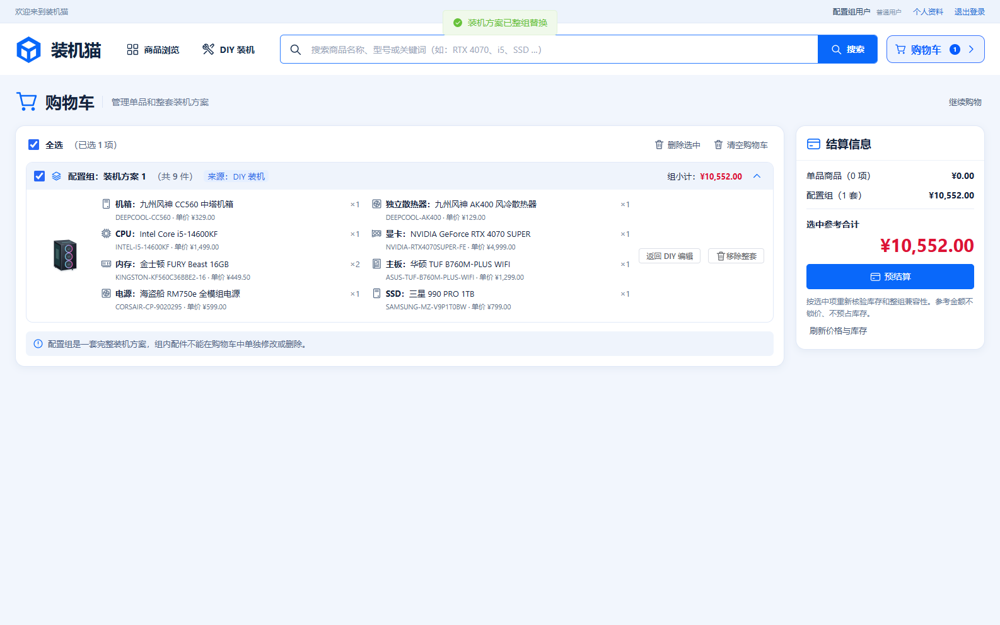
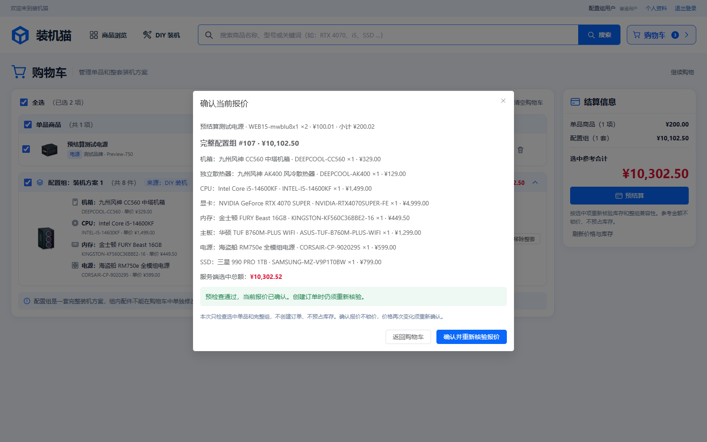

# 任务15验证记录

执行日期：2026-11-11（Asia/Shanghai）。任务：[配置组修改、失效诊断与混合预结算](../../.scratch/pc-mall/issues/15-cart-checkout-preview.md)。契约：[整组编辑与预结算](../cart-checkout-preview.md)。

## 基准与边界

用户确认以开始前 `08da702685db620929f8ad4d4a13652c9ea4d6a9` 为审查基准，沿用公开 HTTP 接口、浏览器可观察行为和真实隔离 MySQL 的测试边界。当前分支 `Test`；开始时已有 `AGENTS.md` 修改和未跟踪 `.idea/jsLibraryMappings.xml`，本次不修改或提交这两项。

复用已有 V19/V20/V22、购物车事务与 F03；没有迁移、依赖升级或外部代码/数据。保留九项核心规则、明确核显/独显选择与内存1～4根。预检查不创建订单或预占库存。

## 命令与环境

Windows、JDK21、MySQL8，使用项目 `test` profile、明确隔离的 `pc_mall_test` schema 及同名受限账户。SQL 只布置私有夹具、注入故障、协调外部事务及清理；购物车结果通过公开 HTTP 验证。

```powershell
$env:JAVA_HOME = 'D:\Java'
$env:MAVEN_USER_HOME = Join-Path $PWD '.local/maven-user'
. ./.local/env.ps1
./mvnw.cmd '-Dtest=CartCheckoutPreviewTest' test
./mvnw.cmd '-Dtest=CartCheckoutPreviewTest,ConfigurationCartTest,SingleItemCartTest' test
cd frontend
npm.cmd run typecheck
cd ..
./scripts/test.ps1
```

开发浏览器循环使用忽略目录内 `.local/task15-browser.ps1`：复用原测试脚本，仅将后端全测替换为编译、浏览器目标限定为 `cart-checkout-preview.spec.ts`，仍使用独立测试服务、同源JAR、临时管理员及原清理流程。

最初沙箱内 MySQL 连接被系统拒绝；随后一次沙箱外启动发生连接失败。使用项目既有 `local-db.ps1 start` 确认实例可用后，真实测试运行正常。环境失败未计为业务测试红灯，没有重建或删除数据库。

## 先失败后通过

| 切片 | 实际失败 | 实现后的结果 |
| --- | --- | --- |
| 原子编辑 | 替换接口不存在，预期200实际500 | 保留组ID替换成功，旧修订409且原车不变 |
| 参数失效诊断 | 缺失参数后组没有 `UNVERIFIED` 状态 | 当前参数重新检测，区分不兼容/无法验证，原组及明细保留 |
| 混合预检查 | 预检查接口不存在 | 单品与完整组服务端报价、选中同SKU聚合、二次变价确认通过 |
| 浏览器编辑 | 找不到“返回 DIY 编辑”按钮 | 取消无写入，保存后仍为同ID的一组 |
| 浏览器报价 | 找不到“预结算”按钮 | 当前报价明细、变价提示、重新确认和子集预检查通过 |
| 审查发现的导航恢复 | 编辑草稿3根内存，切到商城再回DIY后预期3、实际1 | 原方案备份和编辑草稿随editing上下文保留；返回仍3根，取消恢复独立方案2根且购物车原组不变 |

浏览器第一次编辑回归在测试定位“内存”按钮时失败；现有按钮实际为“替换 内存”，修正定位后通过。导航测试首次返回默认CPU面板，内存输出未显示；补上打开内存面板后才以“预期3、实际1”确认业务红灯。未将定位失败冒充业务缺陷证据，也未为测试改变既有按钮契约。

本机红绿日志为 `.local/task15-red-*`、`.local/task15-green-*`；后端专项日志 `.local/task15-backend.log`，完整回归日志 `.local/task15-full.log`。日志及临时脚本不提交。

## 场景与验收关联

任务关联 F05-T15、T16、T19～T23、SYS-T07、SYS-T11。没有本地原报告/矩阵文件，以下按仓库任务和母规格记录本次实际可观察场景，不冒称跨任务原验收已全部完成。

| 场景 | 观察结果 |
| --- | --- |
| 原组安全编辑 | 内存1→2根，组ID不变，金额10102.50→10552.00；过期修订与原组参数快照拒绝 |
| 真实数据库回滚 | 私有内存SKU临时 CHECK 约束使替换明细写入失败；返回503，公开读取与失败前完全相同；finally移除约束 |
| 配置冲突与并发 | 替换为另一组已有配置409且原组不变；两个编辑者屏障同时启动，恰好一个成功、另一个409，最终读取等于成功结果 |
| 当前失效保留 | 清空参数→无法验证，换AMD主板参数→C01不兼容，库存0→缺货，下架→下架；技术与库存原因同时保留 |
| 选中范围 | 不兼容组未选中时CPU单品可预检查；全车同SKU总量超库存时只选有效组仍通过；浏览器失效单品取消勾选后完整组通过 |
| 精确混合报价 | 组10102.50＋CPU单品2×1499.00＝13100.50，SKU需求3；变价1500.01后13103.53，再确认才READY |
| 协调并发调价 | 外部真实商品写事务持锁，预检查等待；提交1500.01后返回10103.51和重新确认状态，拒绝旧报价静默通过 |
| 归属与输入 | 匿名401、缺CSRF403、他人组/项404、重复选择/组内部分选择字段/客户端金额/身份字段400、过期购物车409 |
| 无预占 | 初次及确认预检查前后库存与预占数完全相同，购物车项目仍在；预检查没有订单或库存写入路径 |
| 浏览器并发编辑 | 编辑中另一请求加单品，保存旧编辑显示并发冲突；原完整组不变，取消后返回购物车 |
| 浏览器导航与取消 | 独立DIY内存2根→编辑车内1根组→草稿3根→商城→DIY仍3根→取消恢复独立2根，车内原组不变 |

专项结果：后端购物车31/31通过（当时任务15为6项，另含任务14的10项与单品15项）；随后补充第7项并发编辑及参数快照/无预占断言，纳入完整回归。Edge任务15专项最初3/3通过，审查修复后4/4通过，开发构建均执行TypeScript检查。

## 完整回归与审查

原命令 `./scripts/test.ps1` 完整退出0：真实隔离MySQL后端 **163/163通过**（含任务15的7项），TypeScript、Vite及同源JAR打包通过，Edge全套 **94/94通过**（4.1分钟）。没有失败或跳过的后端用例。脚本正常停止自身测试服务并清理临时管理员。

完整回归重写的13张原有截图，已从开始前基准只读提取字节恢复，仅保留任务15的两张新截图；用户原有AGENTS和IDE改动未包含在提交中。实现提交为 `60665df`，导航恢复修复提交为 `8417be3`，当前分支仍为 `Test`。

初次独立规范审查0项、规格审查发现1项P2导航恢复缺陷。补充上述红绿测试并修复后，两轴独立复查均为0项未解决发现。[两轴审查记录](task-15-review.md)保留发现及处置过程。

修复后重新运行原完整脚本，后端仍为163/163通过，类型、构建及同源打包通过；浏览器在第41项通过后因用户中断停止，不能当作95项完整通过。该次日志为 `.local/task15-full-final.log`。

恢复任务后，以 `.local/task15-final-browser.ps1` 重新执行全部浏览器回归：相对原脚本仅将已通过的后端全测替换为编译，其余类型检查、构建、同源打包、95项浏览器测试及隔离服务/管理员清理流程相同。中断后的本机MySQL已停止，先用既有 `local-db.ps1 start` 启动原实例再运行，没有重新初始化数据库。最终该脚本退出0：类型检查、Vite、同源JAR打包通过，Edge **95/95通过**（2.8分钟），测试服务与本次临时管理员正常清理。日志为 `.local/task15-browser-final.log`。

恢复后的第一次运行中，临时管理员登录401，相关后台用例失败。核对发现用户中断留下了本任务12:30创建的唯一 `webadm_` 管理员；已有管理员会使正常初始化跳过新账户。停止该失败测试进程并让原脚本清理服务后，在 `pc_mall_test` 中以ID、随机名称、ADMIN角色及创建时间精确匹配，只移除该自建遗留夹具（影响1行），再重跑。失败记录保存在 `.local/task15-browser-resume-admin-failed.log`，未修改认证逻辑或削弱测试。

最终代码验证结果为：后端163/163、浏览器95/95、类型与构建全部通过；规范与规格两轴均0项遗留。最终回归生成的原有截图再次恢复为开始前内容，任务15状态已设为 `resolved`。收尾只更新任务与证据文档，不再改动已审查的代码。

## 实际界面

已查看实际 Edge 截图，确认组ID保持、内存数量、整组操作、服务端明细和确认提示可见。右侧始终为参考金额，弹窗使用服务端本次报价。





## 交接限制

报价比较指纹不代表锁价或授权；F06必须重新验证修订、服务端购物项、现价、参数/F03及同SKU需求，再在订单事务内预占。没有实现订单、支付、报价持久化或库存预占。并发行为用例不是任务24的压力/P95验收。
