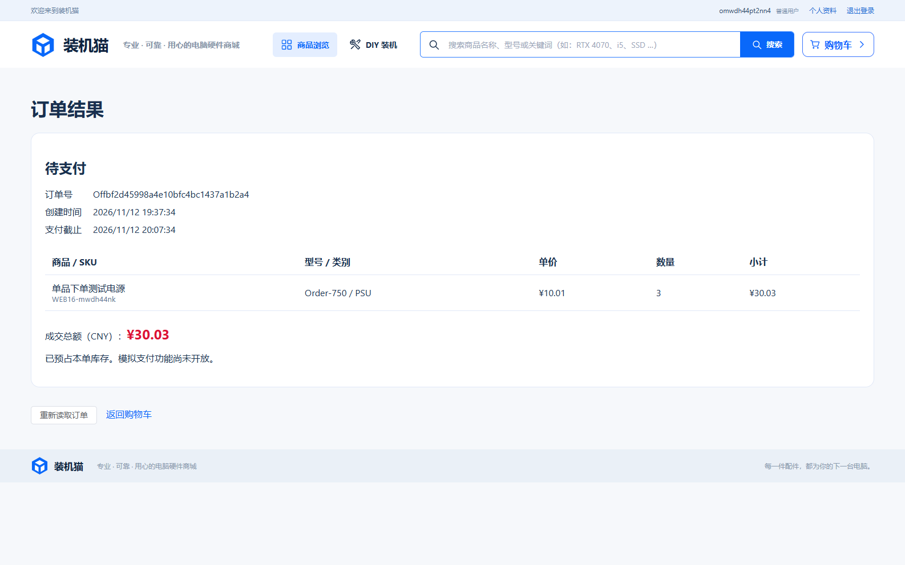

# 任务16验证记录

执行日期：2026-11-12（Asia/Shanghai）。任务：[单品原子下单与成交快照](../../.scratch/pc-mall/issues/16-single-item-order.md)。接口及锁契约：[单品订单](../single-item-orders.md)。

## 基准与范围

用户确认以 `05f5752c3bc7dad9739a455e8ce690901fc66d7e`（Task-15）为审查基准。沿用母规格已确认的公开后端业务接口、浏览器可观察行为与隔离真实 MySQL 测试边界。前置任务07和13均为 resolved。只实现单品，配置组明确拒绝；支付、取消、超时、订单列表由后续任务接入。

当前分支 main；开始时已有 AGENTS.md 修改与未跟踪 .idea/jsLibraryMappings.xml，均未修改或纳入本任务提交。实现提交 `25fdc0f`，审查恢复修复 `b51252f`。新增 V23，无依赖升级、外部代码复制或新数据导入。仓库没有原始docx/xlsx，因此不宣称直接核验其细项；场景关联依据已存任务和母规格。

## 命令与环境

Windows、JDK21、项目 MySQL8；使用 `test` profile、`pc_mall_test` schema和同名受限账户。测试护栏保持启用，未连接演示库。SQL仅布置私有夹具、协调外部写事务、注入故障和清理；行为断言通过HTTP完成。

```powershell
$env:JAVA_HOME = 'D:\Java'
$env:MAVEN_USER_HOME = Join-Path $PWD '.local/maven-user'
. ./.local/env.ps1
./mvnw.cmd '-Dtest=SingleItemOrderTest' test
cd frontend
npm.cmd run typecheck
cd ..
./scripts/test.ps1
```

开发浏览器循环使用忽略目录 `.local/task16-browser.ps1`，相对原脚本仅把后端全测改为编译、浏览器限定为 `single-item-order.spec.ts`。保持相同隔离服务、临时管理员、类型检查、同源打包及清理流程。

首次沙箱内MySQL连接被系统拒绝；获准本机连接后发现原实例未启动，以既有 `local-db.ps1 start` 启动原实例，没有重建数据库。两次环境失败不计功能红灯。

## 实际红绿与专项结果

| 场景 | 观察与结果 |
| --- | --- |
| 首次下单红绿 | 新HTTP测试预期200、接口不存在实际500；实现后通过。首轮绿测的商品夹具缺参数导致详情503，补齐夹具后通过，未改商品契约 |
| 最后一件库存竞争 | 屏障同时发起，两用户首次得到200/503，暴露幂等查询的间隙锁竞争；改用 READ_COMMITTED 并保留全部显式行锁后200/409，库存不超卖 |
| 首次重复与成功重放 | 三个同键首次请求同时到达，均200且订单完全一致；只预占一次。成功后清车、商品变更后同内容重试仍返回原单；同键不同内容409 |
| 精确成交与部分清车 | 3×10.01＝30.03，未选单品保留；PENDING_PAYMENT、CNY、截止恰为服务端创建后30分钟；后续名称/型号/价格/上下架不改快照 |
| 所有权与输入 | 匿名401、缺CSRF403、他人购物项/订单404；客户端身份/明细/价格/数量、重复JSON字段400；配置组409明确拒绝 |
| 二次变价与过期内容 | 连续两次变价各拒绝旧指纹；购物车数量变化拒绝旧修订；重新报价确认后可成交 |
| 六处事务故障 | 订单头、第二条快照、第二条预占明细、购物车删除、购物车修订和幂等记录写入分别制造数据库约束失败；503后购物车/库存不变，撤销故障后原键可成功并安全重放 |
| 后台库存竞争 | 真实管理员减库存与下单屏障同时执行，恰好一个200、一个409；后台公开结果的可售量/预占量和购物车与胜出结果一致 |
| 购物车并发编辑 | 数量修改若先提交，下单409且保留新数量；下单若先提交，编辑404且只扣成交数量 |
| 正在写入的价格 | 外部事务持商品写锁，下单等待；提交新价后409要求重新确认，库存与购物车不产生部分变化 |
| 浏览器红绿 | 报价确认后找不到“创建订单”按钮；实现后真实Edge创建并查看快照、刷新结果地址通过 |
| 浏览器变价与未知结果 | 确认后管理员再次调价，创建被拒并要求重新确认；之后拦截并丢弃已成功提交的响应，刷新空购物车后用原请求重试找回同一订单，预占总量未重复增加 |
| 审查恢复红绿 | 首次POST发出前阻断，实际未提交；重试CSRF拒绝仍保留原请求；后台再次变价后重试，原实现只显示未知而永远卡住，新增Edge断言真实失败。保留业务错误代码并仅对幂等查询之后的确定冲突释放尝试，回归通过并可再次确认后按10.03成交 |

订单专项最终8/8通过；Edge专项1/1通过（同一完整路径内含变价和丢响应场景）；TypeScript与Vite及同源JAR构建通过。以上协调并发测试不代表任务24的压力/P95验收。

清车故障首次采用独立临时表，测试账户没有DROP权限，故清理失败。随后仅用root精确删除本次自建 `pc_mall_test.delete_guard_o16015ef3`，清理本次 `o16015ef3` 私有夹具，改为 shopping_cart 临时列/外键并在finally撤销，未扩大账户权限。该次失败记录保留在 `.local/task16-boundaries.log`，不当作通过。改正后的 `.local/task16-boundaries-final.log`、`.local/task16-focused-final.log` 均成功。

本机红绿日志为 `.local/task16-red-order.log`、`.local/task16-green-order.log`、`.local/task16-red-concurrency.log`、`.local/task16-green-concurrency.log`、`.local/task16-red-browser.log`、`.local/task16-browser-boundaries.log`；日志与临时脚本不提交。

## 完整回归与独立审查

初版 `./scripts/test.ps1` 完整退出0：后端171/171、Edge96/96，TypeScript、Vite及同源JAR打包通过，日志 `.local/task16-full.log`。新增审查恢复回归是在该批浏览器测试已加载后写入，不能把初版全绿当作已覆盖该回归。

随后 `.local/task16-red-recovery.log` 确认业务红灯：期望显示“报价或商品信息发生变化”，实际一直显示“下单结果暂未确认”。修复后 `.local/task16-green-recovery.log` 真实Edge1/1通过，覆盖丢成功响应、CSRF拒绝保留以及未提交后变价的恢复；类型和构建通过。此前一次专项启动被测试端口占用护栏拒绝，没有运行用例，待原服务清理后再跑，未复用他人服务。

独立规范初审0项；独立规格初审发现上述1项P2，完成红绿修复后，原两位代理分别独立复查，最终Standards 0项遗留、Spec 0项遗留；详见[两轴审查](task-16-review.md)。

修复后再次运行原 `./scripts/test.ps1`，完整退出0：真实MySQL后端 **171/171通过**（含本任务8项）、Edge **96/96通过**（4.1分钟，包含完整恢复回归），TypeScript、Vite及同源JAR打包均通过。日志 `.local/task16-full-final.log`。没有失败或跳过的后端测试，测试脚本正常清理自身服务及本次临时管理员。最终只更新任务状态与证据文档，不再修改已审查并验证的代码。

已查看真实Edge成交截图，确认订单号、待支付状态、成交明细、精确金额、创建及截止时间可见。测试重写的13张原有截图恢复为开始前字节，仅保留本任务截图。



## 交接

任务主责关联F06-T01、T02、T05、T06、T07、T11～T17；本次证明上述表格中的单品行为，混合订单、支付、取消/超时与后续状态竞争留给关联任务联合验证。浏览器幂等重试上下文保存在当前页面运行期，关闭/重载页面后需后续订单列表找回历史；成交数据已持久化，不受该上下文生命周期影响。
