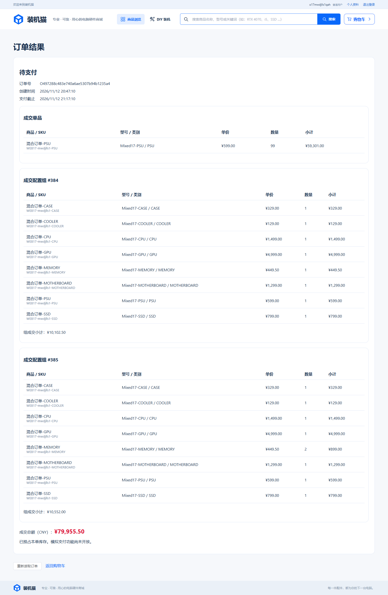

# 任务17验证记录

执行日期：2026-11-12（Asia/Shanghai）。任务：[配置组混合下单与SKU聚合](../../.scratch/pc-mall/issues/17-mixed-order.md)。契约：[混合订单](../mixed-orders.md)。

## 范围与环境

用户确认以开始前 `ce499ad80f53b48a99606b2c364c2d4f4eab54d6` 为固定审查基准。测试在公开HTTP、隔离真实MySQL和浏览器可观察行为边界执行。前置15、16已resolved。当前分支 `Test`，已有AGENTS、前端类别/图标/相关测试及IDE配置变更保留且不纳入任务提交。

Windows、JDK21、MySQL8，使用 `test` profile、`pc_mall_test` schema及同名受限账户；护栏保持启用。SQL只安排私有夹具、故障、外部写事务及清理；断言通过HTTP完成。V24保存组快照并约束明细归属，没有升级依赖、复制外部代码或导入外部数据。仓库未包含原始docx/xlsx，因此关联场景依据本地任务及母规格，不宣称直接核验原文细项。

## 命令

```powershell
$env:JAVA_HOME = 'D:\Java'
$env:MAVEN_USER_HOME = Join-Path $PWD '.local/maven-user'
. ./.local/env.ps1
./mvnw.cmd '-Dtest=MixedOrderTest,SingleItemOrderTest,CartCheckoutPreviewTest' test
cd frontend
npm.cmd run typecheck
cd ..
./scripts/test.ps1
```

开发浏览器脚本 `.local/task17-browser.ps1` 沿用原隔离服务、临时管理员、类型检查、同源打包与清理流程，仅将后端全测替换为编译、浏览器限定为 `mixed-order.spec.ts`。本机连接首次受沙箱限制，后获准连接隔离测试库；未连接演示库或重建数据库。

## 实际红绿及专项

| 场景 | 实际结果 |
| --- | --- |
| 混合成交红绿 | 旧实现409 `MIXED_ORDER_NOT_SUPPORTED`；接入统一事务后通过。99件单品加两套共享CPU按101件聚合；17条明细、两个组、组小计及归属分别保留，成交169055.50 |
| 完整性红绿 | 修改私有组的CPU数量为2，旧诊断仍valid，断言实际失败；补齐类别唯一、内存1～4及其余各1件校验后通过 |
| 最终准入 | 缺散热器、未知参数、不兼容主板、下架、缺货、101件需求仅100库存均409整单拒绝；其他组及单品保留。连续两次变价各要求重新确认 |
| 六处故障回滚 | 第二组快照、第二组成员、预占明细、整组删除、购物车修订和幂等记录分别制造数据库约束失败；503后购物车及库存不变，撤销故障后原键成功并安全重放 |
| 归属与拆组 | 他人组/订单404，客户端组内配件、来源、旧结论、数量及其他额外字段400，伪造组内商品为普通项404；未选无效组与单品保留，选中有效组可独立成交 |
| 并发争库存 | 两个混合订单屏障同时购买有限库存，恰好200/409；败方整组及单品保留，库存为0；胜方并发原键重试均得到原组快照 |
| 参数写入竞争 | 外部事务持商品写锁修改主板参数，创建等待；提交后最终校验读取新参数并拒绝，未预占且整组保留 |
| 历史稳定 | 后续名称、型号、价格、参数和上下架改变，HTTP订单结果及同键成功重放保持原成交快照 |
| 浏览器红绿 | 旧界面在报价确认后“创建订单”仍禁用，真实Edge断言失败；开放混合下单及分组解析/展示后通过 |
| 浏览器聚合及恢复 | 私有8类商品、99件单品和两套完整组；库存减少1件后下单拒绝，预占仍0。伪造拆组400；网络边界503后购物车保留；真实成交但返回缺分组响应时拒绝展示部分成功，原请求重试找回同单且总预占101 |
| 浏览器历史 | 成交79955.50，按单品和两个完整组展示，组内各8条；后台变价/下架后刷新，快照完全一致 |

浏览器503为响应边界注入，不是数据库写入故障证据；真实回滚由上表MySQL故障覆盖。协调并发不代表任务24的压力/P95验收。支付、取消/超时和后续状态竞争不在任务17范围。

首轮绿测出现两项测试问题：把449.50的单根内存误按449.00计算，随后改为独立核对后的精确字面金额；清理夹具时组合外键要求先删除组明细。精确清理该次自建 `o170a742fhappy` 夹具后改进清理顺序，未放宽约束或账户权限。这些失败不计为通过。

相关后端专项 **22/22通过**（混合7、单品8、预结算7），真实Edge专项 **1/1通过**，TypeScript、Vite及同源JAR构建通过。开发日志保留在忽略目录 `.local/task17-*`，包括红灯 `red-mixed-local`、`red-completeness`、`red-browser`，绿灯 `green-mixed-final`、`green-completeness`、`green-browser` 及 `focused`。

## 最终回归与审查

实现提交 `d00d986`。两个独立审查代理分别按规范与规格审查；Standards初审0硬性违规、2项P3重复逻辑建议，Spec初审0项。`bd0f360`将预结算复用现有订单报价选择入口，购物车/订单共用私有成员结构谓词；原代理分别复查后两轴均0项遗留。详见[独立审查](task-17-review.md)。

首轮原 `./scripts/test.ps1`：后端 **178/178通过**，Edge **83/97通过、14失败**（4.8分钟）；TypeScript、Vite及同源JAR通过，脚本正常清理自身服务与临时管理员，整体退出1。该轮完整日志 `.local/task17-full.log` 保留，不能当作全量通过。

其中1项失败是本任务浏览器私有夹具复用了模板主板型号，退架后仍影响既有后台B760M搜索；改为独立品牌与 `Mixed17-类别` 型号，并只修正本次创建的 `WEB17-%` 私有夹具，验证模板型号碰撞为0。其余13项由开始时已有“CPU散热器”重命名使旧 `^CPU` 同时匹配两类导致。用户明确确认修正定位并完成全量回归，故只在三个辅助函数和三处直接CPU定位增加类别后的空格边界。原有类别改动和其他用户工作未覆盖，也未提交；使用 `git apply --cached --unidiff-zero` 仅暂存本次单行补丁。

测试修复提交 `d343cad`、`61a8403` 均已由两个原审查代理独立复查，最终两轴仍0项遗留。首轮后端编译早于规范整理，浏览器构建晚于整理；最终将再次运行原脚本，覆盖最终代码与测试。

受影响的5个浏览器文件 **44/44通过**（1.8分钟），日志 `.local/task17-browser-regression.log`。随后重新执行原 `./scripts/test.ps1`，最终完整退出0：隔离真实MySQL后端 **178/178通过**（含本任务7项）、Edge **97/97通过**（4.4分钟）、TypeScript、Vite及同源JAR构建均通过，无失败或跳过的后端测试。最终日志 `.local/task17-full-final.log`。脚本正常停止自身服务并删除本次临时管理员。

收尾只更新任务状态、契约说明和证据，没有继续修改已审查验证的代码。任务17全部验收项已勾选，状态更新为 `resolved`。恢复测试重写的13张原有截图，并验证35张原有PNG均与测试前备份字节一致；只新增本任务成交截图。只读核验MySQL中任务17故障约束及清车保护列均为0，无临时DDL遗留。

已查看最终真实Edge截图：单品99件、两个配置组、组内内存1/2根、组成交小计、成交总额、待支付状态和截止时间清晰可见。



主责关联F06-T03、T04、T08、T09、T10、T12、T14、T15、T17及SYS-T07/T08。本次证据限于上述混合创建、聚合与回滚行为；支付、列表、取消/超时和后续状态竞争由关联任务接续。不将本轮协调并发当作任务24压力/P95通过。
